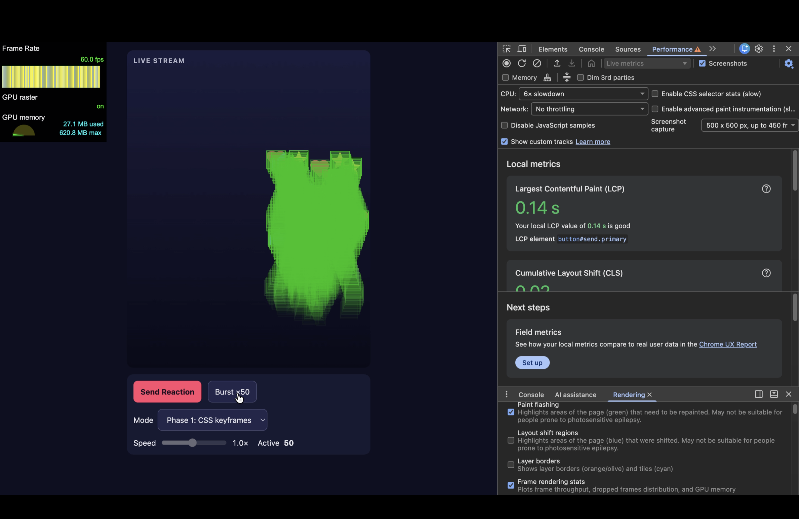
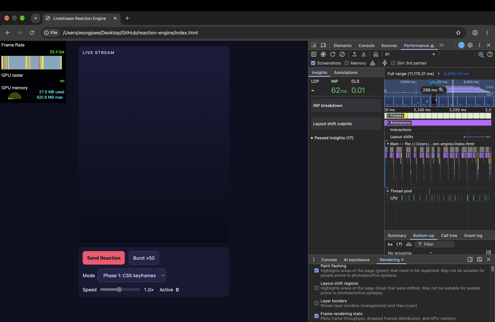
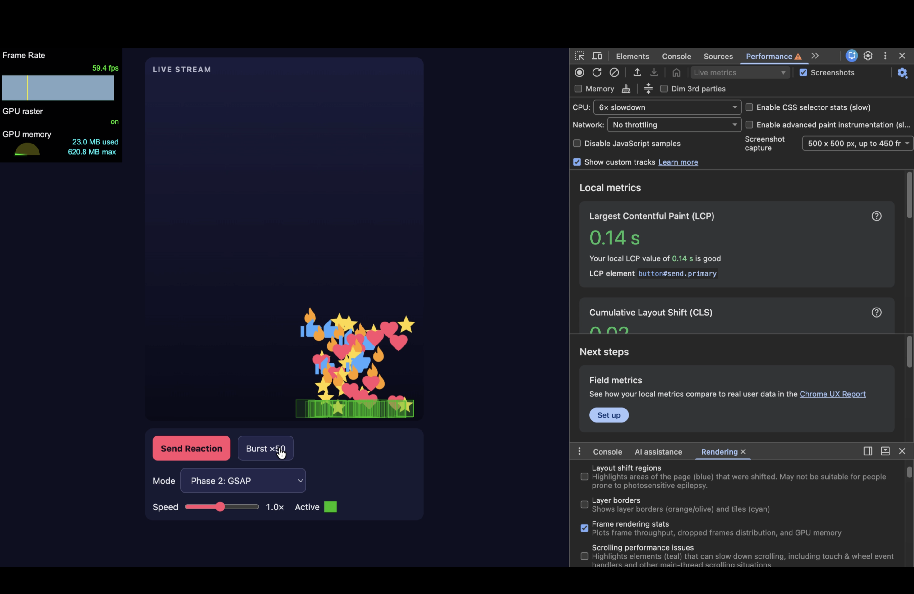

# Livestream Reaction Engine — Submission

## 1. Setup & Running Instructions

Open `index.html` in Google Chrome. Phase 2 needs an internet connection to load GSAP.

Use the Mode dropdown to switch between phases. I used Burst ×50 and 6× CPU slowdown in Chrome DevTools for both tests. I kept GSAP at 1.0× for the comparison.

## 2. Phase 1 — CSS Keyframes Analysis

(Screenshots:ScreenRecordings/Phase1.mov)

- **Paint flashing** — The green flashes were around the icons as they rose on the right side of the stage. The animation changes `bottom`, `margin-left`, and `font-size`, so Chrome has to update the layout and repaint those areas.
- **Main thread** — Recalculate Style, Layout, and Paint showed up repeatedly during the burst as the icons moved and grew.

## 3. Phase 2 — GSAP & Composited Rendering Analysis

(Screenshots:ScreenRecordings/Phase2.mov)

- **Flame chart and frame rate** — Less repeated Layout and Paint work. The frame-rate overlay showed around 60 FPS.
- **Paint flashing** — Green flashes near the bottom when new icons appeared and around the controls when their values changed. No flashing around the icons once they were in the air.
- **Speed test** — Moving the slider to 0.1× slowed down the reactions that were already in the air.

## 4. Architectural Reflection

### Runtime control

A random sway and travel distance was set using CSS when each reaction starts. The keyframes follow that path at a fixed speed. With GSAP, each reaction has a timeline, so `timeScale()` was used to change its speed while it is moving. I can also change its path in JavaScript by starting a new tween from its current position.

### Vector assets

I used SVG icons because they stay sharp when scaled and I can change their colors with CSS. Pre-rendered images could require separate versions for different sizes or themes. SVG lets me reuse the same shapes.
